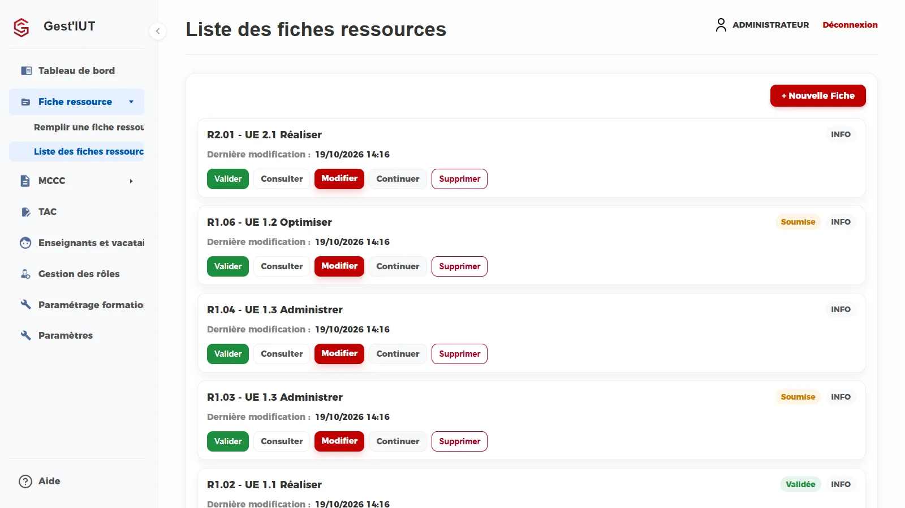
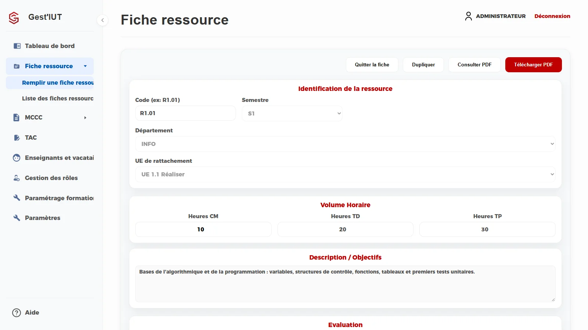
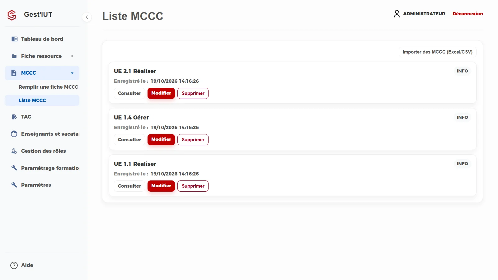
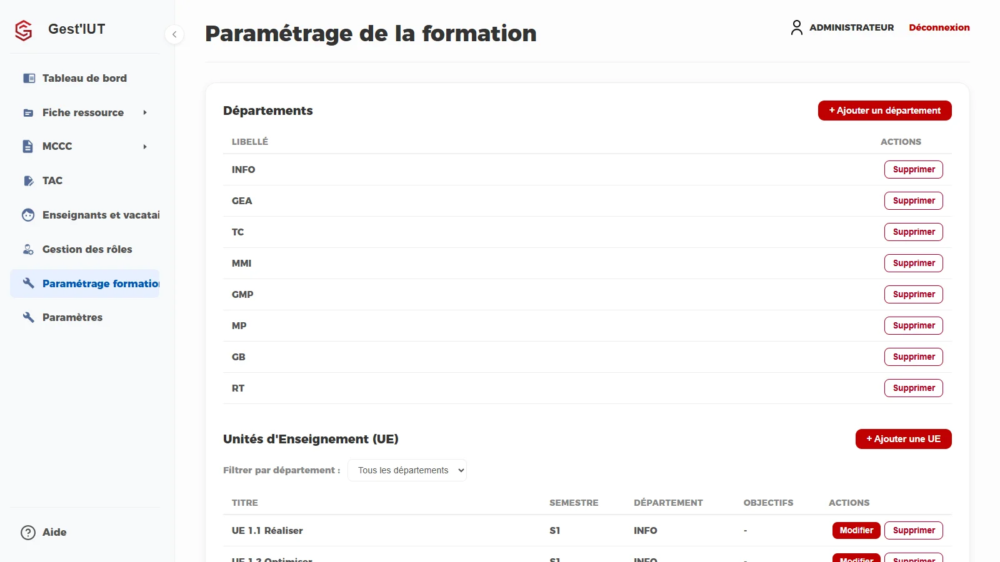
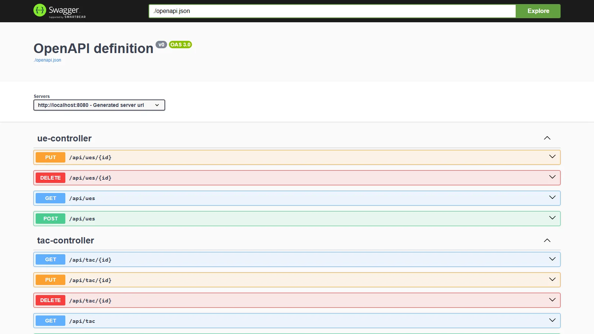

 

---

## 👋 Bonjour, je suis Benjamin

**Étudiant en BUT Informatique à l'IUT du Limousin.** Je suis actuellement en 3e année, en alternance de 12 mois à Limoges.

🎯 Développeur polyvalent, du besoin métier jusqu'au déploiement · curieux de l'écosystème DevOps, des projets industriels et de la data / IA.

- 🏭 **En ce moment :** alternant développeur dans une entreprise industrielle
- 🔭 **Projet perso :** [KiraFlip](https://github.com/bmarty75/kiraflip)
- 🌱 **J'apprends :** le machine learning (apprentissage supervisé, traitement de données)
- 🚀 **Objectif :** devenir ingénieur en IA

---

## 🛠️ Stack technique

  

<b>Voir le détail</b>

 

| Domaine | Technologies |
|---|---|
| **Langages** | Java · Python · JavaScript · PHP · SQL |
| **Back-end** | Spring Boot · Spring Security (JWT) · JPA / Hibernate · Flyway · API REST |
| **Front-end** | Vue.js · HTML / CSS |
| **Bases de données** | PostgreSQL · MySQL |
| **DevOps & outils** | Docker · Docker Compose · Git / GitHub · Linux · Nginx · IntelliJ · VS Code |

---

## 📂 Projets en vedette

### 🃏 KiraFlip, tracker d'achat-revente de cartes Pokémon et One Piece
Projet personnel développé seul, à partir de ma propre activité de revente. Site web et application iOS (disponible sur l'App Store) pour suivre son stock, ses ventes et ses bénéfices, avec une cote du marché mise à jour automatiquement pour chaque carte ou produit scellé, en 8 langues. Une extension Chrome pré-remplit aussi les annonces Vinted, Leboncoin et eBay.

`JavaScript` `Node.js` `Firebase` `Capacitor` `Playwright` `Vercel`

🔗 [kiraflip.com](https://www.kiraflip.com)

### ⚽ Prédiction de résultats sportifs (en cours)
Projet personnel en Python pour prédire les résultats de matchs de football et d'autres sports. Pour le football, le modèle estime les buts attendus de chaque équipe avec une loi de Poisson, à partir de ses forces d'attaque et de défense.

`Python` `Modélisation statistique`

### 🏛️ ERP universitaire (IUT du Limousin)
Application de gestion des dossiers et des processus d'un centre de formation, développée en équipe de 5. Elle est accessible sur un serveur Linux de l'université (hors production).

`Java 21` `Spring Boot 3` `Spring Security (JWT)` `JPA / Hibernate` `PostgreSQL` `Vue.js` `Docker` `Nginx`

🎬 Voir la démo et les captures d'écran

 

https://github.com/user-attachments/assets/d8b9eade-4670-4b52-9a10-b5b0f58de88c

  
  
  
  
  

### 📅 unilim-edt, générateur d'emplois du temps
Projet de SAÉ en équipe de 4 : reprise et poursuite d'une application existante qui génère les emplois du temps des BUT 1, 2 et 3 du département, avec saisie des contraintes, édition manuelle et export des heures des enseignants.

`Laravel` `PHP` `Vue.js` `Inertia` `Tailwind` `MariaDB` `Docker`

### 🎮 Latice, jeu de plateau hawaïen
Adaptation du jeu de plateau Latice, d'abord en console puis avec une interface graphique JavaFX. L'architecture orientée objet a été modélisée en UML.

`Java` `JavaFX` `UML`

🔗 [projet-latice](https://github.com/bmarty75/projet-latice)

---

⭐ **Ouvert à toute opportunité dans le développement logiciel**

